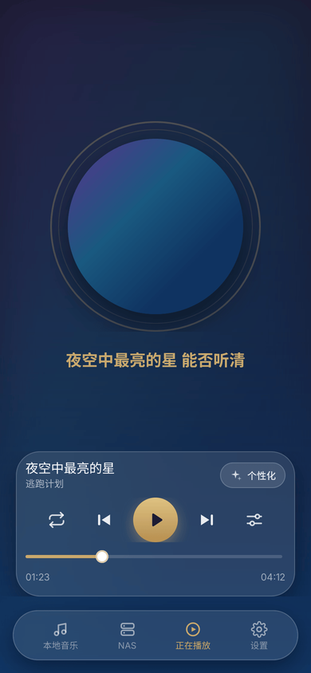
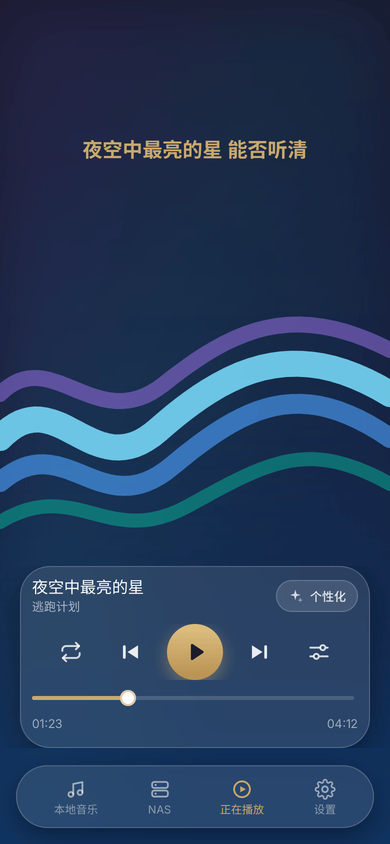
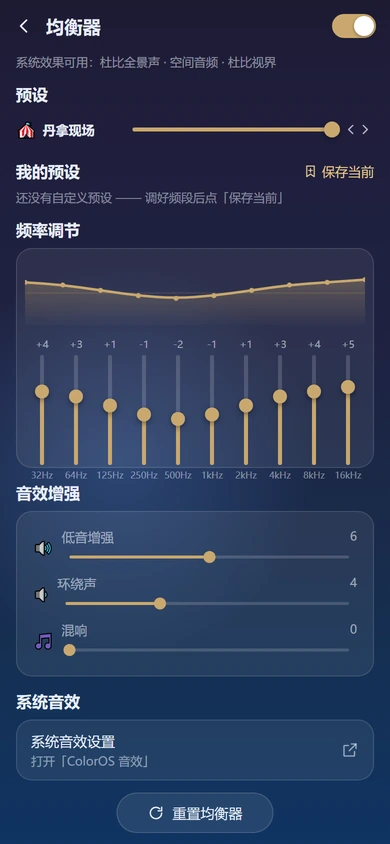
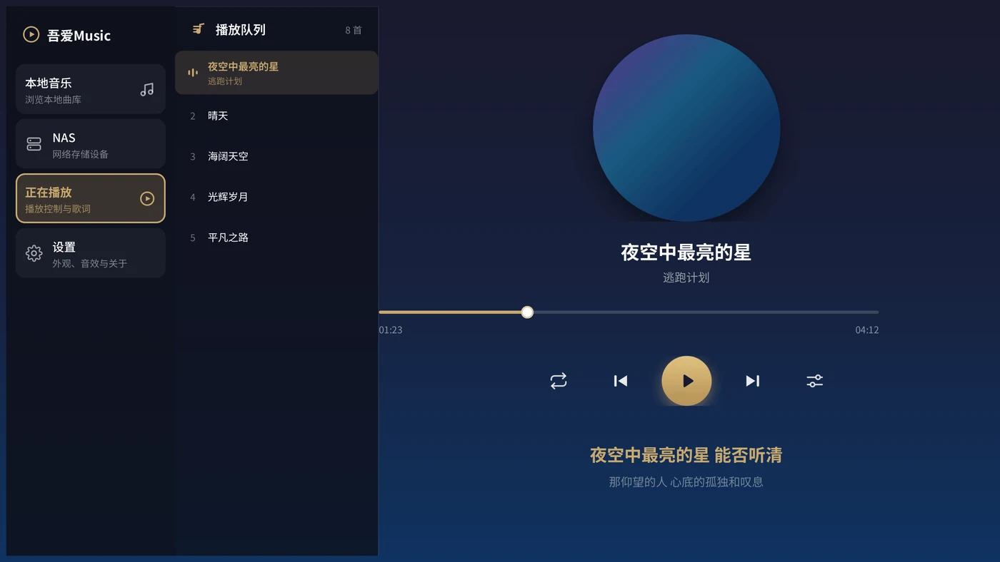
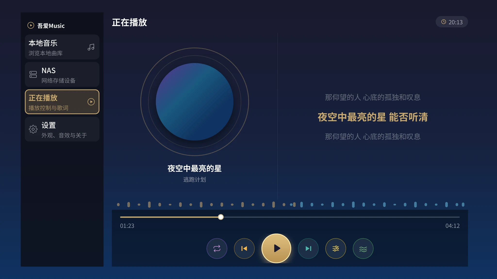

# 吾爱音乐

**手机 · 车机 / 平板 · 电视 · Windows 都能用的本地音乐播放器**

[官网](https://music.52ta.top) · [更新日志](https://music.52ta.top/#changelog) · [常见问题](https://music.52ta.top/#faq) · [问题反馈](https://github.com/jim-6688/wuai-music/issues)

> **本仓库是发布页。** 只提供安装包、更新日志与问题反馈，**不包含源码**。
> 功能说明、截图与常见问题以[官网](https://music.52ta.top)为准。

## 下载

四种构建分别对应四类设备，文件名里的 `phone` / `hd` / `tv` 就是它，**别装错端**：

| 设备 | 构建 | 系统要求 | 国际（GitHub） | 国内（码云） |
|:---|:---|:---|:---|:---|
| 手机 | `phone` | Android 7.0+ | [前往下载](https://github.com/jim-6688/wuai-music/releases/latest) | [arm64](https://gitee.com/jinghe-net/wuai-music/releases/download/latest/app-phone-release.apk) · [32 位](https://gitee.com/jinghe-net/wuai-music/releases/download/latest/app-phone-release-v7a.apk) |
| 车机 / 平板 | `hd` | Android 7.0+ | [前往下载](https://github.com/jim-6688/wuai-music/releases/latest) | [arm64](https://gitee.com/jinghe-net/wuai-music/releases/download/latest/app-hd-release.apk) · [32 位](https://gitee.com/jinghe-net/wuai-music/releases/download/latest/app-hd-release-v7a.apk) |
| 电视 | `tv` | Android 7.0+ | [前往下载](https://github.com/jim-6688/wuai-music/releases/latest) | [arm64](https://gitee.com/jinghe-net/wuai-music/releases/download/latest/app-tv-release.apk) · [32 位](https://gitee.com/jinghe-net/wuai-music/releases/download/latest/app-tv-release-v7a.apk) |
| Windows | `pc` | Windows 10 / 11（64 位） | [安装包](https://github.com/jim-6688/wuai-music/releases/latest)（`WuAiMusic-<版本>-setup.exe`） | — |

- **Android**：`32 位` 那份是给较老的 `armeabi-v7a` 设备准备的，体积反而更大；近几年的手机、电视盒子装 **arm64** 即可。
- **Windows**：下载 `WuAiMusic-<版本>-setup.exe` 直接安装，无需另装运行库。
- 国内链路由码云托管，指向最新版，不需要翻页找版本号；国际链路在 GitHub Releases 里按版本挑选。
- **应用内自带更新检查**，装好之后新版本会自己提示，新用户只需要下载这一次。

## 功能

### 播放

- 支持 **16 种音频格式**：MP3 / M4A / AAC / FLAC / WAV / WMA / OGG / Opus / AIFF / ALAC / APE / MPC / WV / TTA，以及 **DSD（`.dsf`）**。
- 播放器无法直接解封装的格式（APE / WavPack / TTA / DSD）会先转成 FLAC / PCM 再播，点开就能听，不用手动转换。
- 无缝续播、后台播放、通知栏与锁屏控制、耳机线控。

### 音效与可视化

- **10 段均衡器**（32Hz ~ 16kHz），内置多组预设（中性 / 现场 / 人声等），支持自行调节并保存。
- 低音增强、环绕、混响、响度、自动音量等音效开关。
- **4 款可视化**：极光、黑胶、星云、喷泉。

### 曲库与整理

- **本机曲库扫描**，支持选择目录、增量刷新。
- **NAS**：同时支持 **SMB** 与 **WebDAV**；进 NAS 页会自动发现局域网内的设备（含主机名识别与内网/外网地址判断），填一次用户名密码即可接入，**认证成功后自动扫描成歌单**，不需要手动挑目录。
- **CUE 分轨**：整轨镜像按曲目拆开，专辑信息与封面沿用；支持 `.m3u` / `.m3u8` 播放列表。
- **批量修复标签与内嵌封面**，可一次处理整个目录。
- 删除 NAS 设备时，歌单里来自它的曲目会一并清理，不留断档记录。

### 歌词

- 优先读取音频同目录的 `.lrc`（含内嵌歌词）。
- 支持自行添加多个歌词服务器，多路交叉比对后取最匹配的一份。
- 滚动歌词、整体时间偏移微调、桌面歌词样式。

### 多端协同

- **扫码配对**：手机与电视 / 车机配对后，歌单与 NAS 配置一起同步过去。
- **投屏播放**：手机选曲，电视出声，媒体信息与进度双向同步。

### 界面

- **11 套配色**，明暗各一套（合计 22 种主题），支持自定义强调色。
- Liquid Glass 玻璃设计语言，深浅色跟随系统。
- 电视端全程遥控器方向键操作、超大焦点与字号；车机端大按钮、强光下可读。

### 其他

- **无账号、无广告、无会员**，打开就能听。
- 桌面图标可跟随当前配色切换（手机 / 车机）。

## 截图

| 播放 | 可视化 | 均衡器 |
|:---:|:---:|:---:|
|  |  |  |

| 车机 / 平板 | 电视端 |
|:---:|:---:|
|  |  |

## 隐私

曲库扫描、标签与封面读取、播放解码全部在本机完成，**音频文件不会离开你的设备**。

联网只发生在你主动触发的地方：在线找歌词、在线找封面、检查更新。

**日志与崩溃上报已默认关闭并停用**：应用不会再向任何服务器发送运行日志或崩溃信息。本地仍会记录日志，仅存在你自己的设备上，需要时可在「关于」里手动导出，用于自助排查或反馈。

权限只用在该用的地方：

| 权限 | 用途 |
|:---|:---|
| 音乐和音频 | 读取本机曲库 —— 核心功能 |
| 相机 | 扫码配对（不使用则不会请求） |
| 附近的设备 | 发现局域网内的 NAS（不使用则不会请求） |
| 通知 | 媒体播放通知与更新提醒 |

**不申请「照片和视频」权限** —— 封面一律从音频文件内嵌图片读取，不读相册。

## 问题反馈

- 遇到问题或想提建议：请开一个 [Issue](https://github.com/jim-6688/wuai-music/issues)。
- 提问前可以先看一眼[常见问题](https://music.52ta.top/#faq)，答案可能就在里面。
- 崩溃类问题如果能附上从「关于 → 导出日志」拿到的日志，排查会快很多。

## 更新日志

每个版本的改动都写在[官网的更新中心](https://music.52ta.top/#changelog)。App 内的更新弹窗与页面展示的是同一份内容。

## 第三方组件与许可

以二进制形式随应用分发的第三方组件及其许可证，见 [THIRD_PARTY_NOTICES.md](THIRD_PARTY_NOTICES.md)。

## 许可证

[MIT License](LICENSE)

## ☕ 支持与赞助

如果这个应用对你有帮助，欢迎请作者喝杯咖啡 ☕

| 支付宝 | 微信 |
|:---:|:---:|
|  |  |

## 致谢

本程序在 **[QCLaw](https://github.com/nicepkg/qclaw)** 与 **[WorkBuddy](https://www.codebuddy.cn)** 的协助下开发完成。感谢以下开源项目：

- [Flutter](https://flutter.dev)
- [just_audio](https://pub.dev/packages/just_audio)
- [Riverpod](https://riverpod.dev)
- [Phosphor Icons](https://phosphoricons.com)
